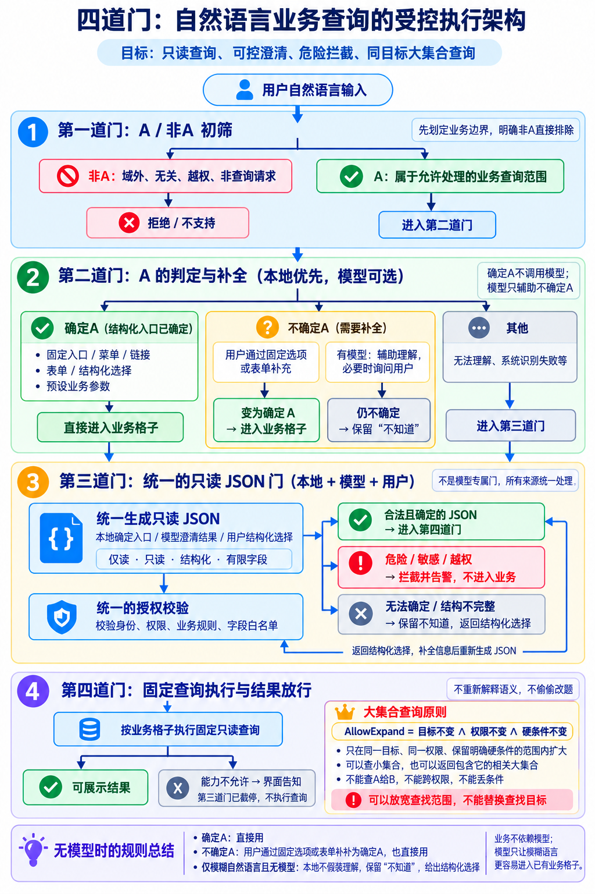

# 青野

**校园社团活动与共享资源管理系统的设计与实现**

青野围绕「社团 → 活动 → 报名 / 候补 → 器材预约 → 审批 → 领取 → 归还」建立业务闭环。学生、社团负责人和管理员共用一个原生微信小程序，管理操作集中在工作台。

## 主要功能

| 使用者 | 功能 |
| --- | --- |
| 共用 | 演示登录与会话、个人资料、本人记录、消息已读、选择清理与回收站恢复、只读校园助手 |
| 同学 | 活动搜索与推荐、报名与候补、取消报名、入社申请与退出 |
| 社团负责人 | 本社团资料与成员审批、活动创建和修改、参与名单、为社团活动申请器材 |
| 管理员 | 社团创建与负责人交接、活动审核、器材数量维护、预约审批、实物领取与整单归还、运行状态 |

完整模块关系见 [功能模块图](功能模块图.html)，下载后双击 HTML 即可离线查看，也可打印或保存 PDF。

## 数据库与后端设计

MySQL 共九张表：`app_user`、`club`、`club_member`、`activity`、`registration`、`equipment`、`loan`、`notification`、`message_task`。完整初始化入口是 [qingye.sql](../sql/qingye.sql)，应用建表定义位于 [schema.sql](../backend/src/main/resources/schema.sql)。

- 负责人身份属于具体社团的成员关系。后端每次请求重新读取用户与社团权限，跨社团和其他用户的私有记录不能访问。
- 活动报名先锁活动行；名额满后进入候补，取消后按顺序递补。
- 器材按同类数量管理。预约在 `[start,end)` 上扫描占用峰值，复杂度为 `O(n log n)`；审批事务通过器材行锁重新裁决容量。计划预约与实物借出分开，领取时再次检查全部未归还数量。
- 消息内容与投递任务分表；业务变化、通知及任务在同一事务中保存。消息清理只软删除所选本人记录，可在回收站勾选恢复，保留原已读状态。删除满 7 天立即不可恢复，后台每分钟分批清理到期消息及对应投递任务，报名与借用事实不受影响。

后端保持一个 Spring Boot 单体，按变化原因组织 `model`（数据契约）、`business`（规则和事务）、`db`（查询）、`api`（接口）及 `integration`（外部能力），不拆微服务。

## 增强能力与边界

Redis 缓存公共列表，失效时回 MySQL。RabbitMQ 负责通知传输，数据库任务保留事实，不可用时本地处理。
校园助手保留四道门：初筛、确定性/模型澄清、有限只读协议与授权、按业务格子执行固定查询并返回事实。
业务目录、表单和固定入口先独立成立，模型只辅助模糊定位；新增社团/活动/器材是数据更新，不需要修改格子或提示词。
相关集合可以扩大，用户明确条件和权限不能扩大或丢失；不擅自加日期或把摄影替换成艺术大类。
必要条件缺失才澄清，每请求最多五次主动提问，已明确信息保留。第五次已确定照常查询，否则暂停自动询问；范围确认和技术重试不混算。模型选择有限问题类型，界面不透传任意模型追问文案。
第三门限定能力、参数和认证会话身份；第四门以固定 SQL 与字段投影兑现同一个已确认计划，本地不再重解释原句。本人记录始终按会话主体过滤，管理员也不扩大助手数据范围。
实际结果有分页与明确的候选/零匹配说明；合法计划、用户确认和事实正确不自动证明用户意图匹配。详见[业务优先合同 v5](assistant-business-first-v5.md)。旧版本的实验仍保持原版本资格。

本轮冻结题集对 DeepSeek 与千问共完成 372 次真实调用：250 次形成预期查询，94 次正确停止，28 次与冻结预期不符；未观察到写操作或读取他人私有数据。阶段版本证明的是模型可选、有限只读、主体隔离、危险拦截与固定查询闭合，不证明模型对任意自然语言的解释正确。结构、授权与来源均合法仍可能发生时间角色绑定错误，该一般性反例移交 VeriTrail 独立保存，不在青野继续增加语义解析权力。

仓库运行步骤和测试命令见 [README](../README.md)。截至 2026-10-02，H2 / MySQL 各 43 项、前端 39 项和十页原生编译通过，包含双请求并发、权限隔离及状态流转。Redis / MQ 的实际传输、降级与恢复，以及外部模型样例和受控异常已检查。本轮 6 类真实 DeepSeek 查询、16 个本地拒绝样例及认证、参数边界通过，九张业务表内容一致；包含正文卡住的超时降级验证。

本轮新增回收站已在微信开发者工具实际编译页面验收：勾选清理与恢复、取消操作、原已读状态与个人页红点、账号隔离、空状态及到期定时清理均通过。

登录页对身份列表加载及登录故障提供持续可见的提示，覆盖 403、404、429、5xx、断网、超时和无效响应，可重试或返回选择身份；异常响应不会建立会话。

用户在安卓手机确认了助手按钮、预约连续填写和昵称弹窗三组键盘避让。其他机型未逐一验证；真实微信登录、正式 HTTPS、微信审核、学校部署和高负载容量不属于当前验收范围。默认交付不含模型密钥，助手仅为标准入口提供本地兜底，复杂表达需要模型或澄清。历史验收过程保留在 Git 历史，当前目录仅保留交付说明。

2026-10-08 的[语义污染对照](semantic-comparison-20261008.md)另有已知功能失败：两个模型各跑同一 133 题，
权限及只读边界未被击穿，但本地规则会将历史借用误判为当前本人查询，或抓住已否定的器材名称。
模型与本地查询类型一致不证明它们理解了用户最终意图。该记录绑定旧候选，不代表新版结果；
新[能力合同 v3](assistant-contract.md)明确替代类型优先级与通用语义兜底，语义质量另用冻结问题对照验证。
